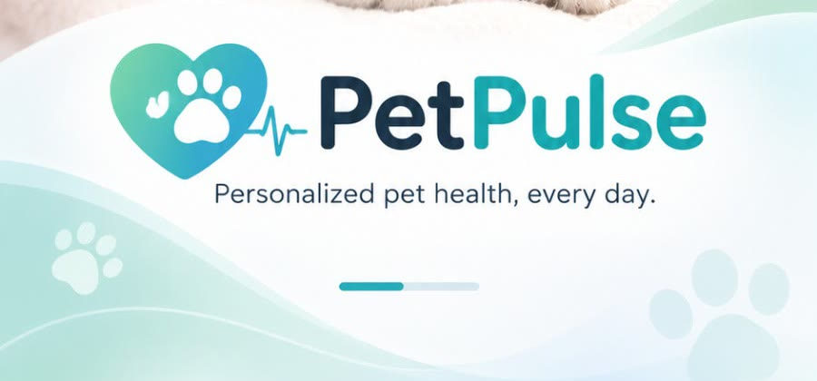
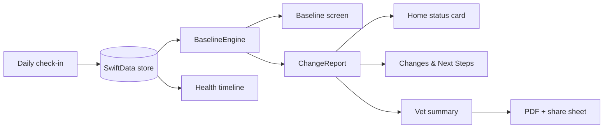

<p align="center">
  
</p>

<h1 align="center">PetPulse</h1>
<p align="center"><b>Know your pet. Sooner.</b><br>A native iPhone app that learns what is normal for <i>your</i> pet and flags meaningful change early.</p>

<p align="center">
  
  
  
  
  
  
  
  
</p>

`daily check-in` · `voice check-in` · `personal baseline` · `change detection` · `health timeline` · `vet-ready PDF summary`

## Contents

- [Overview](#overview)
- [Status at a glance](#status-at-a-glance)
- [Quick start](#quick-start)
- [Demo script](#demo-script)
- [How change detection works](#how-change-detection-works)
- [Voice check-in](#voice-check-in)
- [Repository map](#repository-map)
- [Architecture](#architecture)
- [Configuration](#configuration)
- [Testing](#testing)
- [Privacy and safety](#privacy-and-safety)
- [Roadmap](#roadmap)
- [Contributing](#contributing)
- [License](#license)

## Overview

Pets cannot say when something hurts. They show it through small changes in appetite, drinking, stool, activity and appearance, and first-time owners often miss them. Generic symptom checkers ask "is this normal for a cat?". PetPulse asks "is this normal for **my** cat?".

The owner logs a short daily check-in. The app builds a per-pet baseline, compares the most recent days against it, explains what changed and by how much, suggests whether to keep monitoring or see a vet, and produces a structured summary the vet can read in a minute.

PetPulse supports monitoring and triage. It does not diagnose.

## Status at a glance

| Area | State | Notes |
|---|---|---|
| 8 screens from the mockup (splash, profile, home, check-in, baseline, changes, timeline, vet summary) | Source-complete | Compiles with the iOS 27.1 SDK |
| Voice check-in (on-device Whisper transcription, transcript → form fields) | Source-complete | Compiles and parser tests pass; not yet tried on a device; similarity threshold is untuned |
| More screen with demo controls | Source-complete | Not in the mockup; reached from the More tab |
| Baseline and change-detection engine | Source-complete | Pure Swift, covered by unit tests (passing) |
| Vet summary PDF export and share sheet | Source-complete | Single-page vector PDF |
| On-device persistence | Source-complete | SwiftData, no account |
| Multimodal AI (photo, video and audio analysis) | Roadmap | Detection today is statistical and rule-based |
| Multiple pets, reminders, vet portal | Roadmap | |

Known visual differences from the mockup: icons are vector redraws (SF Symbols plus custom shapes), the logo is redrawn in SwiftUI, and photos are the real cat pictures rather than the mockup's stylised renders.

## Quick start

Requires a Mac with **Xcode 16 or later**. Xcode fetches one Swift package, [WhisperKit](https://github.com/argmaxinc/argmax-oss-swift) (pinned to 1.1.0), the first time the project opens.

```bash
open PetPulse.xcodeproj
```

Pick an iPhone simulator and press Run. To run on a device, set your team under *Signing & Capabilities*.

If Xcode refuses to open the project file, regenerate it with [XcodeGen](https://github.com/yonaskolb/XcodeGen):

```bash
brew install xcodegen && xcodegen generate
```

## Demo script

1. **Get Started** → the profile is prefilled for Mochi → **Save Profile**. This also loads 28 days of healthy history.
2. **Home** shows "No meaningful change detected". Open **Baseline** to see the learned patterns.
3. Tap **Start Daily Check-in**, lower *Dry food* and *Energy level*, and **Save Check-in**. The app jumps to **Changes & Next Steps**.
4. For the exact mockup numbers (dry food −40%, activity −30% over 3 days), use **More → Simulate a 3-day change**.
5. **Create Vet Summary** → **Share Report** exports the PDF and logs it on the **Timeline**.

**More → Reload healthy history** resets the demo.

## How change detection works

Implemented in [`PetPulse/Engine/BaselineEngine.swift`](PetPulse/Engine/BaselineEngine.swift).

- **Usual value:** the median of up to 28 days before the latest check-in, per metric. A median means a few odd days do not drag the reference with them.
- **Change:** the latest day deviates from usual by 20% or more. The run is the number of consecutive most-recent days deviating the same way.
- **Reported size:** the mean of the run compared with usual.
- **Minimum history:** 6 check-ins before anything is reported.
- **Wording:** [`Narrative.swift`](PetPulse/Engine/Narrative.swift) turns the report into plain language with fixed rules. A large (60%+) or long (5+ days) change escalates the recommendation to contacting a vet.

Metrics tracked: dry food, wet food, water, stool frequency, activity, and optional weight.

## Voice check-in

Tap the microphone on **Daily Check-in**, describe the day in your own words, then **Use This** to fill the form. You still review and save the check-in yourself.

- **Speech to text:** OpenAI's open-source Whisper model, run on the phone through WhisperKit (Core ML). [`SpeechTranscriber.swift`](PetPulse/Voice/SpeechTranscriber.swift) re-transcribes the clip about once a second while you speak, then once more when you stop. Clips are capped at 30 seconds.
- **Understanding:** [`VoiceParser.swift`](PetPulse/Engine/VoiceParser.swift) splits the transcript into clauses and reads each one for a topic (food, water, stool and urination, activity) and a level. Clear wording is matched directly. Phrasing with no known keyword or cue is matched by meaning, using Apple's on-device sentence embedding (`NLEmbedding`) against example phrases.
- **Values:** "less" becomes 70% of the pet's usual value, "a little less" 85%, "normal" the usual value, and the same upwards (115%, 130%). Explicit amounts such as "40 grams" or "100 ml" are used as spoken. Anything not mentioned keeps the value already in the form, and the transcript is added to Notes.

The first use downloads the Whisper model from Hugging Face, which needs a connection and can take a while on a large model. Mood, coat and eyes are not set by voice.

## Repository map

| Path | Role |
|---|---|
| `PetPulse/App/` | App entry, root routing, navigation routes |
| `PetPulse/Theme/` | Colours, fonts, logo, icons, shared components |
| `PetPulse/Models/` | SwiftData models: `Pet`, `DailyCheckIn`, `TimelineEvent` |
| `PetPulse/Engine/` | Baseline maths, narrative wording, voice transcript parsing, demo data |
| `PetPulse/Voice/` | Whisper transcription and sentence embedding |
| `PetPulse/Views/` | One file per screen |
| `PetPulse/Assets.xcassets/` | App icon, hero art, cat photos |
| `PetPulseTests/` | Unit tests for the engine |
| `PetPulse.xcodeproj/` | Xcode project (synchronized folders: new files are picked up automatically) |
| `Config/Info.plist` | Extra Info.plist keys merged into the generated one (the Whisper model setting) |
| `project.yml` | XcodeGen fallback |

## Architecture



Views read models with `@Query` and pass plain `DaySample` values to the engine, so the engine has no UI or storage dependency.

## Configuration

There are no keys or accounts. One build setting selects the speech model:

| Build setting | Default | Effect |
|---|---|---|
| `WHISPER_MODEL` | empty | Whisper variant to download, for example `openai_whisper-base` (small and fast) or `openai_whisper-small` (better with accents). Empty lets WhisperKit pick the recommended model for the device, which can be several hundred MB. Set it in the target's build settings or pass `WHISPER_MODEL=...` to `xcodebuild`. |

Tunable constants:

| Constant | Default | Effect |
|---|---|---|
| `BaselineEngine.threshold` | `0.20` | Minimum deviation that counts as a change |
| `BaselineEngine.minBaselineDays` | `5` | History needed before detection starts |
| `BaselineEngine.windowDays` | `28` | How far back "usual" looks |
| `VoiceLevel.factor` | `0.7` to `1.3` | How far "less", "a little less", "more" move a value from usual |
| `VoiceParser.minSimilarity` | `0.5` | Minimum embedding similarity before an unfamiliar clause is assigned a topic |
| `SpeechTranscriber.maxSeconds` | `30` | Longest voice clip |
| `DemoSeeder.seedOnFirstProfile` | `true` | Load demo history when the first profile is saved; set `false` for a real install |

## Testing

```bash
xcodebuild test -project PetPulse.xcodeproj -scheme PetPulse -destination 'platform=iOS Simulator,name=iPhone 18 Pro'
```

Or press ⌘U in Xcode. The engine tests cover the median, minimum-history rule, threshold, run length, increases, timeline labels and the demo narrative. The voice parser tests cover the mockup sentence, explicit amounts, negation, abnormal stool and the embedding fallback (with a stand-in embedding). All 20 tests pass on the iOS 27.1 simulator.

## Privacy and safety

- All data, including photos and voice recordings, stays on the device. Nothing is uploaded.
- Voice check-ins are transcribed on the device. Audio is held in memory only while recording and is never saved. The app asks for microphone access the first time.
- The only network request the app makes is downloading the Whisper model from Hugging Face on first use of voice check-in.
- Photos are chosen with the system photo picker, so the app needs no photo-library permission.
- The vet summary leaves the device only when the owner shares it.
- The app describes change relative to a pet's own baseline. It is not a diagnostic tool and does not replace a veterinarian.

## Roadmap

See the product notes kept alongside this repo. Next steps: multimodal analysis of photos, video and sound; reminders; multiple pets; a clinic-facing report format.

## Contributing

Preserve these invariants:

- The engine stays pure Swift with no UI or SwiftData imports.
- Wording never claims a diagnosis.
- No third-party packages without a clear need. WhisperKit is the one exception, pinned to an exact version.
- The AI model name is never written in code; it comes from the `WHISPER_MODEL` build setting.
- No network calls or analytics without an explicit privacy review. The model download is the one reviewed exception; user data must never be sent.

## License

No license file is currently checked in. All rights reserved by the authors until one is added.
