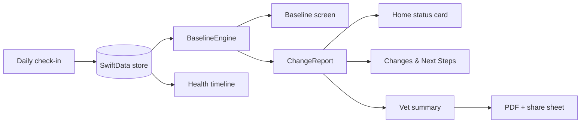

<p align="center">
  
</p>

<h1 align="center">PetPulse</h1>
<p align="center"><b>Know your pet. Sooner.</b><br>A native iPhone app that learns what is normal for <i>your</i> pet and flags meaningful change early.</p>

<p align="center">
  
  
  
  
  
  
  
  
</p>

`daily check-in` · `personal baseline` · `change detection` · `health timeline` · `vet-ready PDF summary`

## Contents

- [Overview](#overview)
- [Status at a glance](#status-at-a-glance)
- [Quick start](#quick-start)
- [Demo script](#demo-script)
- [How change detection works](#how-change-detection-works)
- [Repository map](#repository-map)
- [Architecture](#architecture)
- [Configuration](#configuration)
- [Testing](#testing)
- [Privacy and safety](#privacy-and-safety)
- [Roadmap](#roadmap)
- [Contributing](#contributing)
- [License](#license)

## Overview

Pets cannot say when something hurts. They show it through small changes in appetite, drinking, stool, activity and appearance, and first-time owners often miss them. Generic symptom checkers ask "is this normal for a cat?". PetPulse asks "is this normal for **my** cat?".

The owner logs a short daily check-in. The app builds a per-pet baseline, compares the most recent days against it, explains what changed and by how much, suggests whether to keep monitoring or see a vet, and produces a structured summary the vet can read in a minute.

PetPulse supports monitoring and triage. It does not diagnose.

## Status at a glance

| Area | State | Notes |
|---|---|---|
| 8 screens from the mockup (splash, profile, home, check-in, baseline, changes, timeline, vet summary) | Source-complete | Written on Windows; **not yet compiled or run** |
| More screen with demo controls | Source-complete | Not in the mockup; reached from the More tab |
| Baseline and change-detection engine | Source-complete | Pure Swift, covered by unit tests (not yet run) |
| Vet summary PDF export and share sheet | Source-complete | Single-page vector PDF |
| On-device persistence | Source-complete | SwiftData, no account, no network |
| Multimodal AI (photo, video and audio analysis) | Roadmap | Detection today is statistical and rule-based |
| Multiple pets, reminders, vet portal | Roadmap | |

Known visual differences from the mockup: icons are vector redraws (SF Symbols plus custom shapes), the logo is redrawn in SwiftUI, and photos are the real cat pictures rather than the mockup's stylised renders.

## Quick start

Requires a Mac with **Xcode 16 or later**. No packages to install.

```bash
open PetPulse.xcodeproj
```

Pick an iPhone simulator and press Run. To run on a device, set your team under *Signing & Capabilities*.

If Xcode refuses to open the project file, regenerate it with [XcodeGen](https://github.com/yonaskolb/XcodeGen):

```bash
brew install xcodegen && xcodegen generate
```

## Demo script

1. **Get Started** → the profile is prefilled for Mochi → **Save Profile**. This also loads 28 days of healthy history.
2. **Home** shows "No meaningful change detected". Open **Baseline** to see the learned patterns.
3. Tap **Start Daily Check-in**, lower *Dry food* and *Energy level*, and **Save Check-in**. The app jumps to **Changes & Next Steps**.
4. For the exact mockup numbers (dry food −40%, activity −30% over 3 days), use **More → Simulate a 3-day change**.
5. **Create Vet Summary** → **Share Report** exports the PDF and logs it on the **Timeline**.

**More → Reload healthy history** resets the demo.

## How change detection works

Implemented in [`PetPulse/Engine/BaselineEngine.swift`](PetPulse/Engine/BaselineEngine.swift).

- **Usual value:** the median of up to 28 days before the latest check-in, per metric. A median means a few odd days do not drag the reference with them.
- **Change:** the latest day deviates from usual by 20% or more. The run is the number of consecutive most-recent days deviating the same way.
- **Reported size:** the mean of the run compared with usual.
- **Minimum history:** 6 check-ins before anything is reported.
- **Wording:** [`Narrative.swift`](PetPulse/Engine/Narrative.swift) turns the report into plain language with fixed rules. A large (60%+) or long (5+ days) change escalates the recommendation to contacting a vet.

Metrics tracked: dry food, wet food, water, stool frequency, activity, and optional weight.

## Repository map

| Path | Role |
|---|---|
| `PetPulse/App/` | App entry, root routing, navigation routes |
| `PetPulse/Theme/` | Colours, fonts, logo, icons, shared components |
| `PetPulse/Models/` | SwiftData models: `Pet`, `DailyCheckIn`, `TimelineEvent` |
| `PetPulse/Engine/` | Baseline maths, narrative wording, demo data |
| `PetPulse/Views/` | One file per screen |
| `PetPulse/Assets.xcassets/` | App icon, hero art, cat photos |
| `PetPulseTests/` | Unit tests for the engine |
| `PetPulse.xcodeproj/` | Xcode project (synchronized folders: new files are picked up automatically) |
| `project.yml` | XcodeGen fallback |

## Architecture



Views read models with `@Query` and pass plain `DaySample` values to the engine, so the engine has no UI or storage dependency.

## Configuration

There are no environment variables, keys or network calls. Tunable constants:

| Constant | Default | Effect |
|---|---|---|
| `BaselineEngine.threshold` | `0.20` | Minimum deviation that counts as a change |
| `BaselineEngine.minBaselineDays` | `5` | History needed before detection starts |
| `BaselineEngine.windowDays` | `28` | How far back "usual" looks |
| `DemoSeeder.seedOnFirstProfile` | `true` | Load demo history when the first profile is saved; set `false` for a real install |

## Testing

```bash
xcodebuild test -project PetPulse.xcodeproj -scheme PetPulse -destination 'platform=iOS Simulator,name=iPhone 16'
```

Or press ⌘U in Xcode. The tests cover the median, minimum-history rule, threshold, run length, increases, timeline labels and the demo narrative. **They have not been run yet**: the code was written on a machine without a Swift toolchain.

## Privacy and safety

- All data, including photos, stays on the device. Nothing is uploaded.
- Photos are chosen with the system photo picker, so the app needs no photo-library permission.
- The vet summary leaves the device only when the owner shares it.
- The app describes change relative to a pet's own baseline. It is not a diagnostic tool and does not replace a veterinarian.

## Roadmap

See the product notes kept alongside this repo. Next steps: multimodal analysis of photos, video and sound; reminders; multiple pets; a clinic-facing report format.

## Contributing

Preserve these invariants:

- The engine stays pure Swift with no UI or SwiftData imports.
- Wording never claims a diagnosis.
- No third-party packages without a clear need.
- No network calls or analytics without an explicit privacy review.

## License

No license file is currently checked in. All rights reserved by the authors until one is added.
